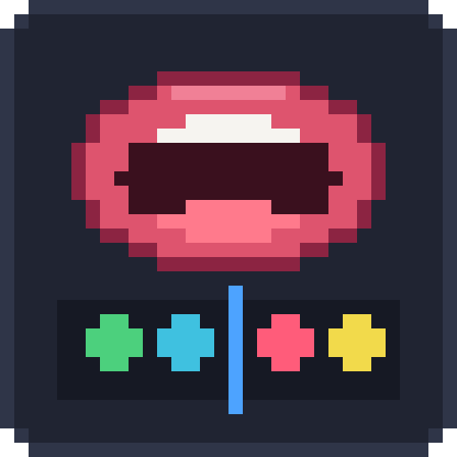

<div align="center">



# BBS Lip Sync

Автоматический липсинк для мода BBS / Automatic lip sync for the BBS mod

**[Русский](#русский) · [English](#english)**

</div>

---

## Русский

BBS Lip Sync — аддон для BBS. Он превращает речь из аудиоклипа или просто набранный текст в кейфреймы рта актёра. Распознавание речи работает офлайн на [Vosk](https://alphacephei.com/vosk/) и поддерживает больше 20 языков. Рот может быть собран из поз модели или из текстур.

### Требования

- Minecraft 1.20.1, 1.20.4, 1.21.1 или 1.21.11, Fabric Loader, Fabric API
- BBS 2.6 для той же версии Minecraft
- Липсинк из аудио работает на Windows x64, Linux x64 и macOS. Липсинк из текста работает везде.

Установка: положите jar аддона для своей версии Minecraft (`BBSLipSync-1.0+1.21.1.jar` и т. п.) в папку `mods` рядом с BBS.

### Липсинк из аудио

1. Добавьте аудиоклип на таймлайн камеры фильма.
2. В редакторе реплеев нажмите правой кнопкой по треку `pose` или `texture` актёра → **«Сгенерировать липсинк»**.
3. Аудиоклип выбирается сам: единственный включённый в фильме или тот, что под курсором. Если подходят несколько, появится список.
4. При первом запуске для языка появится окно скачивания модели распознавания речи. Она скачивается один раз, дальше всё работает без интернета. Генерация начнётся сама, когда модель скачается.

Пока идёт генерация, прогресс рисуется поверх трека, а пункт меню меняется на **«Отменить липсинк»**.

Язык речи выбирается в том же меню, пункт **«Язык речи: …»**, или в настройках. По умолчанию берётся язык игры.

### Липсинк из текста

Правая кнопка по треку → **«Липсинк из текста»**. Введите реплику и выберите скорость речи. Кейфреймы ставятся от курсора таймлайна, аудио не нужно.

- Запятая, точка с запятой, двоеточие и тире дают короткую паузу, рот остаётся открытым.
- Точка, `!`, `?`, `…` и новая строка дают длинную паузу, рот закрывается.
- Рядом с кнопкой видно, сколько секунд и тиков займёт фраза.

### Повторная генерация и отмена

Сгенерированные кейфреймы окрашены в цвет формы рта. При повторной генерации заменяются только они, и только в пределах клипа или фразы. Ваши кейфреймы с эмоциями остаются на месте. Чтобы сохранить сгенерированный кейфрейм, перекрасьте его. Вся генерация отменяется одним Ctrl+Z.

### Настройка рта

Липсинк знает 9 форм рта:

| Форма | Звуки |
|---|---|
| `idle` | закрытый рот, паузы |
| `a` | А, Е, Я, Э |
| `o` | О, Ё |
| `u` | У, Ю |
| `ee` | И, Ы, Й, К, Г, Х, Ш |
| `b` | М, Б, П (губы сомкнуты) |
| `f` | В, Ф (зубы на губе) |
| `d` | Д, Т, С, Н, З, Ж, Ц, Ч |
| `l` | Л, Р |

Хватит и двух форм. Недостающие возьмут похожую.

**Если назвать формы как в таблице, ничего настраивать не нужно:**
- позы модели: `idle`, `a`, `o`… в `poses.json`, как у встроенного рига `player/mouth`;
- текстуры: рядом с текстурой закрытого рта `wemppy.png` лежат `wemppy_a.png`, `wemppy_o.png`… или просто `a.png`, `o.png`… Текстура закрытого рта — та, что стоит у формы.

**Если названия другие**, откройте редактор формы → вкладка **«Липсинк»** (иконка голоса):
- у модели сверху переключатель **Позы / Текстуры**. У billboard и extruded только текстуры;
- клик по строке выбирает позу или картинку и показывает её на форме в превью;
- правый клик по строке → **«Сбросить»**;
- поле со значком ▶ проигрывает фразу на форме, чтобы проверить все формы разом.

Карта трека выбирается по треку: `pose` берёт позы, `texture` — текстуры. У модели можно настроить обе.

Настройки сохраняются в `lipsync.json` и работают для всех форм и фильмов:
- карта поз лежит в папке модели, рядом с `poses.json`;
- карта текстур лежит в папке с картинками рта и привязана к картинке закрытого рта. Поэтому рты нескольких персонажей могут жить в одной папке.

```json
{
    "poses": {"a": "open", "o": "round"},
    "textures": {
        "wemppy.png": {"a": "wemppy_open.png", "b": "wemppy_closed.png"}
    }
}
```

Если переименовать позу или перенести картинки, эту форму нужно выбрать заново.

### Настройки

**Настройки → Липсинк:**

- **Речь:** язык, размер модели (маленькая 30–140 МБ или большая до 2 ГБ, большая точнее слышит слова), выгружать ли модель из памяти после генерации.
- **Тайминг:** пресет **Спокойная / Обычная / Быстрая** и значения под ним — упреждение, минимальная длительность согласной, пауза для закрытия рта, задержка закрытия рта. Если поменять значение вручную, пресет станет «Своя».

### Языки

English, Русский, Українська, Deutsch, Français, Español, Italiano, Português, Polski, Türkçe, Nederlands, Čeština, Català, Svenska, Esperanto, Tiếng Việt, Oʻzbek, Қазақша, Кыргызча, Тоҷикӣ, ქართული, Filipino, Brezhoneg.

Языки без алфавита (китайский, японский, арабский, хинди, корейский) не поддерживаются: формы рта здесь берутся из букв.

Модели лежат в `config/bbs/lipsync/models`. Модель можно поставить вручную: скачайте архив с [alphacephei.com/vosk/models](https://alphacephei.com/vosk/models) и распакуйте в эту папку.

Таблицу букв языка можно переопределить файлом `config/bbs/lipsync/letters/<код>.json`.

### Ограничения

- Распознавание речи не работает на Linux ARM и Windows ARM.
- Для английского и французского буквы плохо передают произношение, липсинк там грубее.
- Не поддерживаются мультитекстуры, спрайт-листы (crop, сдвиг UV) и shape keys.

---

## English

BBS Lip Sync is an addon for BBS. It turns speech from an audio clip, or plain typed text, into mouth keyframes for an actor. Speech recognition runs offline with [Vosk](https://alphacephei.com/vosk/) in over 20 languages. The mouth can be made of model poses or of textures.

### Requirements

- Minecraft 1.20.1, 1.20.4, 1.21.1 or 1.21.11, Fabric Loader, Fabric API
- BBS 2.6 for the same Minecraft version
- Lip sync from audio runs on Windows x64, Linux x64 and macOS. Lip sync from text runs anywhere.

Installation: put the addon jar for your Minecraft version (`BBSLipSync-1.0+1.21.1.jar` and such) into the `mods` folder next to BBS.

### Lip sync from audio

1. Add an audio clip to the film's camera timeline.
2. In the replay editor, right click an actor's `pose` or `texture` track → **Generate lip sync**.
3. The clip is picked for you: the film's only enabled audio clip, or the one under the cursor. If several fit, a list opens.
4. The first time for a language, a window offers to download its speech recognition model. It downloads once and works offline afterwards. Generation starts by itself when the download finishes.

While a job runs, its progress is drawn over the track, and the menu item becomes **Cancel lip sync**.

The speech language is picked in the same menu (**Speech language: …**) or in the settings. By default it follows the game's language.

### Lip sync from text

Right click a track → **Lip sync from text**. Type the line and set the speech speed. Keyframes start at the timeline cursor; no audio is needed.

- A comma, semicolon, colon or dash is a short pause, and the mouth stays open.
- A full stop, `!`, `?`, `…` or a new line is a long pause, and the mouth closes.
- Next to the button you can see how many seconds and ticks the line takes.

### Generating again, and undo

Generated keyframes are painted in their mouth shape's colour. Generating again replaces only those, and only within the clip or line, so your own keyframes (expressions and such) stay. To keep a generated keyframe, recolour it. A whole generation is undone with one Ctrl+Z.

### Setting up the mouth

Lip sync knows 9 mouth shapes:

| Shape | Sounds |
|---|---|
| `idle` | closed mouth, pauses |
| `a` | A, I |
| `o` | O |
| `u` | U, W |
| `ee` | E, K, G, H, Y |
| `b` | M, B, P (lips closed) |
| `f` | F, V (teeth on lip) |
| `d` | D, T, S, N, Z |
| `l` | L, R |

Two shapes are enough. Missing ones borrow a similar shape.

**Name the shapes like in the table and there is nothing to set up:**
- model poses: `idle`, `a`, `o`… in `poses.json`, like the bundled `player/mouth` rig;
- textures: next to the closed mouth texture `wemppy.png`, put `wemppy_a.png`, `wemppy_o.png`… or just `a.png`, `o.png`… The closed mouth texture is the one set on the form.

**If your names differ**, open the form editor → the **Lip Sync** tab (voice icon):
- a model has a **Poses / Textures** switch at the top. Billboards and extruded forms only have textures;
- click a row to pick a pose or picture; the form shows it in the preview;
- right click a row → **Reset**;
- the field with ▶ plays a line on the form, to check all shapes at once.

The track decides which map is used: `pose` takes the poses, `texture` the textures. A model can have both.

The setup is saved to `lipsync.json` and works for every form and film:
- the pose map lives in the model's folder, next to `poses.json`;
- the texture map lives in the folder of the mouth pictures and belongs to the closed mouth picture, so several characters' mouths can share one folder.

```json
{
    "poses": {"a": "open", "o": "round"},
    "textures": {
        "wemppy.png": {"a": "wemppy_open.png", "b": "wemppy_closed.png"}
    }
}
```

If you rename a pose or move the pictures, pick that shape again.

### Settings

**Settings → Lip Sync:**

- **Speech:** language, model size (small 30–140 MB, or large up to 2 GB, which hears words more accurately), and whether to unload the model from memory after generating.
- **Timing:** a **Calm / Normal / Fast** preset and the values under it: anticipation, minimum consonant length, pause before closing the mouth, and delay before closing the mouth. Changing a value by hand makes the preset "Custom".

### Languages

English, Русский, Українська, Deutsch, Français, Español, Italiano, Português, Polski, Türkçe, Nederlands, Čeština, Català, Svenska, Esperanto, Tiếng Việt, Oʻzbek, Қазақша, Кыргызча, Тоҷикӣ, ქართული, Filipino, Brezhoneg.

Languages without an alphabet (Chinese, Japanese, Arabic, Hindi, Korean) aren't supported, because mouth shapes are read from letters.

Models are stored in `config/bbs/lipsync/models`. To install one by hand, download its archive from [alphacephei.com/vosk/models](https://alphacephei.com/vosk/models) and unpack it into that folder.

A language's letter table can be overridden with `config/bbs/lipsync/letters/<code>.json`.

### Limitations

- Speech recognition doesn't run on Linux ARM or Windows ARM.
- English and French spelling says little about pronunciation, so lip sync is rougher there.
- Multi-textures, sprite sheets (crop, UV offset) and shape keys aren't supported.

---

## Building / Сборка

One source tree builds every Minecraft version. The default is 1.20.1 (`mc` in `gradle.properties`); pick another with `-Pmc`:

Один код собирается под все версии Minecraft. По умолчанию 1.20.1 (`mc` в `gradle.properties`), другая версия выбирается через `-Pmc`:

```
./gradlew build
./gradlew build -Pmc=1.21.1
```

In PowerShell, quote the property, otherwise it gets split at the dot / В PowerShell свойство нужно взять в кавычки, иначе оно разобьётся по точке: `.\gradlew.bat build "-Pmc=1.21.1"`.

The jar lands in `build/libs/BBSLipSync-<version>+<minecraft>.jar`. Each version takes its Minecraft, yarn, Fabric API and Java versions from `versions/<minecraft>.properties` and compiles against `libs/bbs-2.6-<minecraft>.jar`.

Jar появляется в `build/libs/BBSLipSync-<версия>+<minecraft>.jar`. Версии Minecraft, yarn, Fabric API и Java берутся из `versions/<minecraft>.properties`, компиляция идёт против `libs/bbs-2.6-<minecraft>.jar`.

---

## Credits / Благодарности

- Speech recognition: [Vosk](https://github.com/alphacep/vosk-api) by Alpha Cephei (Apache 2.0). Each speech model has its own license, see [alphacephei.com/vosk/models](https://alphacephei.com/vosk/models).
- BBS by McHorse and the BBS team.

License / Лицензия: MIT.
